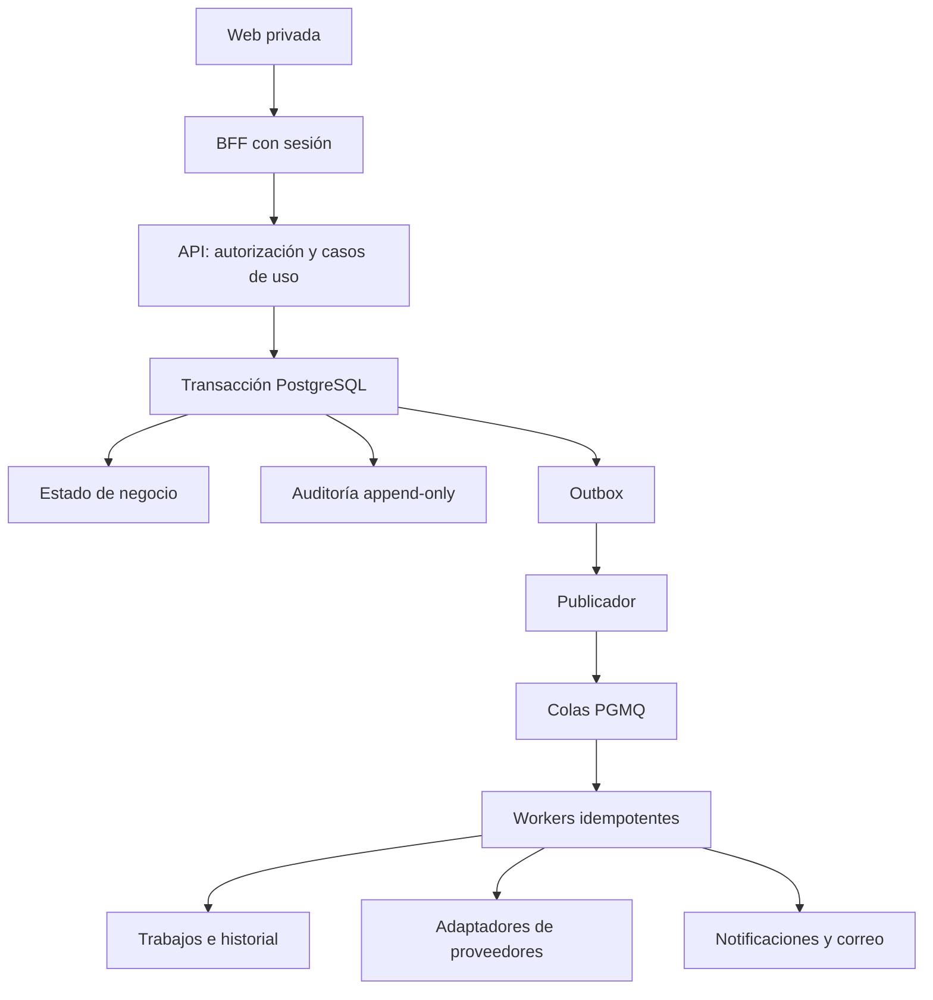

# Fase 5 — Servicios transversales de ICE24 OS

> **Confidencial.** Información propiedad intelectual de ICE24 MX.

| Campo                         | Valor                                                              |
| ----------------------------- | ------------------------------------------------------------------ |
| Documento                     | Guía consolidada de alcance, arquitectura, operación y validación  |
| Fecha de elaboración          | 19/10/2026, America/Mexico_City                                    |
| Alcance                       | F5-01 a F5-15                                                      |
| Evidencia de cierre utilizada | Gate local del 06/10/2026, revisión `cdbded7`                      |
| Dictamen registrado           | Aprobado con pendientes externos; ratificación y firmas pendientes |

Esta guía reúne la documentación de suscripciones, auditoría, archivos, trabajos y notificaciones. Los resultados citados corresponden a la corrida histórica del gate; la elaboración de este documento no constituye una nueva ejecución de pruebas ni una comprobación del despliegue actual.

## 1. Objetivo y fuentes

La fase proporciona los servicios compartidos que necesitan los módulos de negocio: controlar el acceso según la suscripción, conservar evidencia de acciones sensibles, procesar trabajo asíncrono, proteger archivos y comunicar alertas. El cierre técnico permite continuar la Fase 6 en desarrollo; no acredita operación productiva.

El alcance normativo está en el [plan de implementación](../../context/Implementation_Plan.md), las [tareas](../../context/TASKS.md) y las [reglas del proyecto](../../context/PROJECT_RULES.md). El [estado de Fase 5](../backlog/phase-5-status.md) concentra el dictamen y los bloqueos; la [matriz de trazabilidad](../qa/phase-5/traceability.md) vincula criterios, pruebas y evidencias. Los reportes individuales conservan el estado de su fecha y deben leerse junto con ese estado consolidado.

## 2. Entregables y documentación

Las quince tareas constan como integradas en el registro de cierre.

| Tarea                           | Entrega y comportamiento                                                          | Referencia técnica                                      |
| ------------------------------- | --------------------------------------------------------------------------------- | ------------------------------------------------------- |
| [F5-01](../tasks/task-f5-01.md) | Suscripción por cuenta, demo, historia comercial y acceso efectivo                | [Suscripciones](../modules/subscriptions.md)            |
| [F5-02](../tasks/task-f5-02.md) | Checkout y Portal de Stripe, webhooks firmados, deduplicación y reconciliación    | [Operación de Stripe](../runbooks/stripe.md)            |
| [F5-03](../tasks/task-f5-03.md) | Modo lectura aplicado en servidor y explicado en la interfaz                      | [Suscripciones](../modules/subscriptions.md)            |
| [F5-04](../tasks/task-f5-04.md) | Auditoría central append-only y consulta autorizada                               | [Auditoría](../modules/audit.md)                        |
| [F5-05](../tasks/task-f5-05.md) | Outbox transaccional y publicación de eventos                                     | [Outbox](../modules/outbox.md)                          |
| [F5-06](../tasks/task-f5-06.md) | Consumidores idempotentes, reintentos y cola de mensajes fallidos (DLQ)           | [Workers](../modules/workers.md)                        |
| [F5-07](../tasks/task-f5-07.md) | Centro de trabajos, historial y reproceso auditado                                | [Trabajos](../modules/jobs.md)                          |
| [F5-08](../tasks/task-f5-08.md) | Carga directa preautorizada a almacenamiento privado y confirmación en cuarentena | [Archivos](../modules/files.md)                         |
| [F5-09](../tasks/task-f5-09.md) | Integridad, análisis antimalware, promoción o rechazo                             | [Seguridad de archivos](../security/files.md)           |
| [F5-10](../tasks/task-f5-10.md) | Versiones, autorización de descarga y URL temporal auditada                       | [Archivos](../modules/files.md)                         |
| [F5-11](../tasks/task-f5-11.md) | Alertas persistentes por destinatario y transiciones controladas                  | [Notificaciones](../modules/notifications.md)           |
| [F5-12](../tasks/task-f5-12.md) | Correo transaccional, plantillas versionadas y seguimiento de entrega             | [Operación de correo](../runbooks/email.md)             |
| [F5-13](../tasks/task-f5-13.md) | Ventanas programadas, vencimientos y hallazgos de reconciliación                  | [Scheduler](../modules/scheduler.md)                    |
| [F5-14](../tasks/task-f5-14.md) | Logs redactados de integraciones y correlación entre servicios                    | [Logs de integración](../modules/integration-logs.md)   |
| [F5-15](../tasks/task-f5-15.md) | Interfaz común de servicios de cuenta y control de concurrencia                   | [Interfaz de cuenta](../modules/account-services-ui.md) |

## 3. Arquitectura y consistencia

La web privada utiliza el BFF para conservar la sesión en servidor. La API resuelve identidad, cuenta, ámbito y permisos antes de ejecutar casos de uso. PostgreSQL mantiene los cambios transaccionales; el worker procesa las colas persistentes y llama a proveedores mediante adaptadores.

La auditoría y el evento de outbox se confirman junto con la acción de negocio cuando comparten la base transaccional. El envío posterior tolera entregas repetidas: cada consumidor reclama la combinación de su nombre y el ID del evento en la misma transacción que su efecto. Los efectos externos requieren idempotencia propia del adaptador o proveedor.

Los logs técnicos permiten diagnosticar intentos y fallos; no sustituyen la auditoría funcional. La correlación conecta petición, evento, cola, trabajo, proveedor y webhook sin registrar secretos ni payloads sensibles completos.

## 4. Flujos funcionales

### Suscripción y acceso

El estado comercial se conserva separado del modo de acceso. Los estados documentados son `demo`, `pending_activation`, `active`, `payment_failed`, `read_only`, `cancellation_scheduled`, `cancelled` y `reactivated`.

1. Una persona autorizada abre Checkout o Portal; abrir la sesión no activa la cuenta.
2. El webhook verifica firma y concilia la información de Stripe antes de aplicar el cambio.
3. Estado, acceso y auditoría se actualizan de forma consistente.
4. Un pago rechazado activa solo lectura de inmediato, sin periodo de gracia añadido.
5. La API rechaza escrituras de negocio con `403 ACCOUNT_READ_ONLY`; la interfaz muestra el motivo y deshabilita las acciones correspondientes.

Las consultas y descargas conservan su autorización habitual. Facturación y ciertas operaciones propias de identidad y notificaciones tienen excepciones explícitas; no habilitan escritura general. Una suspensión de seguridad no se elimina por un pago confirmado.

Decisiones específicas: [preactivación](../decisions/adr-022-subscription-preactivation.md), [sesiones de Stripe](../decisions/adr-023-stripe-sessions.md) y [reconciliación de webhooks](../decisions/adr-024-stripe-webhook-reconciliation.md).

### Archivos privados

1. La API autoriza el recurso, propósito y ámbito, y emite una sesión de carga temporal.
2. El navegador carga los bytes directamente a almacenamiento privado.
3. La confirmación valida el objeto y lo conserva en cuarentena.
4. El worker comprueba integridad y ejecuta el análisis antimalware.
5. Solo un veredicto limpio permite la promoción; ante fallo del analizador, el archivo permanece en cuarentena.
6. Cada descarga vuelve a autorizarse y genera una URL temporal y un evento de auditoría.

No se entregan URLs públicas permanentes de originales privados. Las versiones y los derivados no implican publicación automática. El modelo de amenazas y los controles están en [seguridad de archivos](../security/files.md).

### Trabajos, reintentos y diagnóstico

El registro utiliza `QUEUED`, `RUNNING`, `SUCCEEDED`, `RETRY_WAIT`, `FAILED` y `DEAD_LETTER`, con historial append-only. Los fallos recuperables siguen la política de reintentos de su cola; al agotarla pasan a DLQ.

El reproceso administrativo exige permiso, MFA, motivo, clave de idempotencia y versión esperada. La transacción conserva el reenvío, la transición y la auditoría. Una versión obsoleta se rechaza con `412`; la pantalla actualiza el detalle antes de permitir una nueva decisión. La operación completa está en [trabajos](../modules/jobs.md) y [colas](../runbooks/queues.md).

### Notificaciones, correo y tareas programadas

Las alertas tienen estado por destinatario: no leída, leída, enterado, en atención y resuelta. Las críticas permanecen fijadas hasta «Enterado»; resolver exige que la condición relacionada esté cerrada.

El consumidor de correo encola las alertas críticas y un procesador separado realiza el envío, con plantillas versionadas, reintentos, DLQ y seguimiento firmado de entrega o rebote.

El scheduler identifica cada ventana por tarea, usa arrendamientos en base de datos y registra trabajos observables. Materializa vencimientos, publica eventos de cierre de periodos de reporte y registra discrepancias con Stripe sin corregirlas automáticamente. La generación de PDF y el productor de reportes corresponden a fases posteriores.

## 5. Interfaz y contratos

Las rutas de servicio documentadas son `/subscription`, `/audit`, `/files`, `/jobs` y `/notifications`. Comparten estados de carga, vacío, error, falta de permiso, desconexión y conflicto, además del aviso global de solo lectura.

Las mutaciones sensibles validan permisos en servidor, idempotencia y versión cuando corresponde. En particular, F5-15 añade `If-Match` al reintento INT-004 y a las transiciones NOT-003 a NOT-006. La matriz del gate registra el desfase histórico D-2 entre algunas filas de `API.md` y este requisito.

Los contratos generales se consultan en [API](../../context/API.md); los detalles de interacción, BFF y concurrencia están en [servicios de cuenta](../modules/account-services-ui.md). Este último documento también incorpora cambios posteriores del shell de Fase 6, que no deben atribuirse a la corrida de cierre de Fase 5.

## 6. Operación y soporte

| Situación                                     | Comprobación y actuación documentada                                                           | Procedimiento                                                                     |
| --------------------------------------------- | ---------------------------------------------------------------------------------------------- | --------------------------------------------------------------------------------- |
| Pago rechazado o estado comercial discrepante | Revisar recibo, firma, correlación y reconciliación; no activar por la redirección de Checkout | [Stripe](../runbooks/stripe.md)                                                   |
| Trabajo fallido o cola acumulada              | Revisar intentos, código, antigüedad y DLQ; corregir la causa antes del reproceso autorizado   | [Colas](../runbooks/queues.md)                                                    |
| Archivo retenido en cuarentena                | Revisar integridad, veredicto y disponibilidad del analizador; conservar cuarentena ante fallo | [Almacenamiento](../runbooks/object-storage.md)                                   |
| Correo sin entrega o rebotado                 | Revisar trabajo, estado del proveedor y callback firmado                                       | [Correo](../runbooks/email.md)                                                    |
| Alerta que no se puede resolver               | Verificar destinatario, versión y cierre de la condición relacionada                           | [Notificaciones](../runbooks/notifications.md)                                    |
| Ventana programada omitida o fallida          | Revisar tarea, ventana, arrendamiento e historial del trabajo                                  | [Scheduler](../runbooks/scheduler.md)                                             |
| Investigación de una acción sensible          | Consultar auditoría y seguir la correlación hacia los logs de integración autorizados          | [Auditoría](../runbooks/audit.md), [observabilidad](../runbooks/observability.md) |

La promoción de entornos sigue el [runbook de despliegue](../runbooks/deployment.md). Esta guía no acredita que las migraciones, servicios o proveedores estén activos en un entorno remoto.

## 7. Validación y criterio de salida

La [declaración de cierre del 06/10/2026](../qa/phase-5/evidence/20261006-declaracion-cierre.md) registra los siguientes resultados sobre `cdbded7`:

| Validación histórica                | Resultado registrado                                                    |
| ----------------------------------- | ----------------------------------------------------------------------- |
| `pnpm check`                        | Salida 0; 408 pruebas en 68 archivos                                    |
| Build con origen local de Storage   | Salida 0; 14 tareas                                                     |
| Integración con Chromium habilitado | 106 pruebas en 14 archivos, sin omisiones                               |
| Escenarios detallados del gate      | 66 pruebas en 8 archivos; subconjunto de validación, no total adicional |
| Supabase local y pgTAP              | 23 migraciones aplicadas; 320 aserciones en 15 archivos                 |

Los cuatro criterios se verificaron localmente: acción sensible con auditoría y eventos; pago rechazado con solo lectura inmediata; archivo privado sin URL pública permanente; trabajo fallido diagnosticable y reintentable.

La [guía QA](../qa/phase-5/README.md) contiene comandos de reproducción y salidas originales. Los conteos corresponden a aquella revisión, no al estado actual del repositorio. El gate utilizó dependencias y proveedores locales o simulados y no acreditó operación contra servicios desplegados.

## 8. Pendientes para puesta en operación

El cierre registra estos pendientes; esta consolidación no los da por resueltos:

| Pendiente                                                        | Referencia            | Efecto                                      |
| ---------------------------------------------------------------- | --------------------- | ------------------------------------------- |
| Validación remota y reconciliación real de Stripe                | F5-02 AC-10, F5-13    | Cobro productivo sin acreditar              |
| Migraciones y despliegue de API, web y worker                    | Despliegue de Fase 5  | Uso real sin acreditar                      |
| Proveedor antimalware                                            | ADR-019 / DEC-019     | Procesamiento de archivos reales pendiente  |
| Proveedor de correo y canal de recuperación                      | DEC-025, DEC-024      | Correo productivo y recuperación pendientes |
| Hospedaje de worker y scheduler                                  | DEC-026 / ADR-021     | Worker en staging pendiente                 |
| Reglas comerciales de mora, reembolso, contracargo y cancelación | DEC-017               | Operación comercial pendiente               |
| Retención, privacidad y tratamiento de cancelaciones             | DEC-008               | Sin plazo de purga ni borrado supuesto      |
| Ratificación formal                                              | Declaración de cierre | Firmas de responsables pendientes           |

Los hallazgos adicionales del gate incluyen accesibilidad manual pendiente, falta de una suite pgTAP específica de suscripciones y evidencias heredadas de Fase 4 fuera de `files.file_versions`. Su alcance histórico y las decisiones documentales D-1 a D-3 se conservan en la [matriz de trazabilidad](../qa/phase-5/traceability.md).

Para continuar la documentación, cada cambio debe actualizar el módulo y runbook afectados, conservar su evidencia y revisar el estado consolidado. La preparación productiva requiere comprobar los pendientes en el entorno correspondiente y registrar las decisiones y aprobaciones aplicables.
