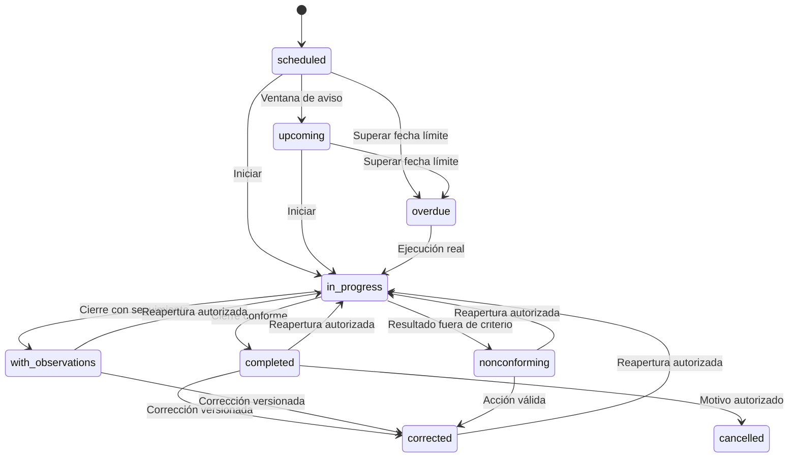

# Mantenimiento

Alcance F7: actividades programadas, tickets, órdenes, evidencia, revisión y sincronización offline. P0 solo prepara demostración y revisión; no ejecuta órdenes reales.

## Entidades y límites

- Actividad programada: `equipment.scheduled_activities`, creada por el worker de F4; conserva definición y frecuencia efectiva. No se crea un calendario paralelo.
- Ticket implementado en P2: reporte inmutable, evidencia privada y diagnóstico versionado. P3 implementa órdenes y sus guardas; ejecución completa, revisión y conflictos corresponden a P4–P11. Las pantallas aún provisionales están marcadas «Maqueta — sin lógica».
- Historial append-only; cancelación de futuras al recalcular, jamás borrado de atrasos. Componentes propios activos y frecuencias máquina → cuenta → plantilla (F4-20/21).

## Estados y eventos

AppFlow §15: Programado → Próximo/Vencido → En atención → Completado/Con observaciones/No conforme; corrección y anulación autorizadas conservan historia. «Crítico» es una señal de prioridad, no una transición adicional.

F4 emite MachineFrequenciesChanged, AccountFrequenciesChanged y eventos de componentes/plantilla; el consumidor encola jobs idempotentes. P3 define eventos y guardas de ejecución. P8 define sincronización idempotente con versión esperada.

## Permisos y offline

Desde UI-MNT-01/02, «código · nombre» enlaza al expediente mediante `/machines?machineId=<uuid>` solo con capacidad de lectura de equipos. El servidor valida UUID y pertenencia al listado autorizado del contexto; valores inválidos o ajenos dejan la pantalla normal sin selección ni revelación de existencia. El expediente existente recibe foco y desplazamiento (inmediato con movimiento reducido), sin drawer/modal. La navegación activa cambia a Máquinas. Dictamen y evidencia: [navegación de máquinas](../qa/phase-7/machine-order-navigation.md). UI-MNT-01/02 y el enlace al expediente cuentan con aprobación UX del usuario solicitante registrada el 06/11/2026.

Toda lectura valida cuenta, sucursal, máquina, módulo y `authorize()`. Las propuestas F7-D01–D06 se detallan en [estado](../backlog/phase-7-status.md); no representan permisos productivos concedidos.

Solo una orden descargada permite trabajo offline (P6–P11). En P0 los controles son simulaciones: no descargan datos ni resuelven conflictos. Revisión UX en [QA](../qa/phase-7/README.md).

## Fuentes

## Implementación P2

UI `/maintenance/tickets`, creación `/maintenance/tickets/new` y detalle por ID, accesibles desde mantenimiento y expediente de máquina. API `/v1/tickets` ofrece lista con cursor, opciones de sistema/componente, detalle, creación idempotente y diagnóstico con versión esperada y motivo. Los componentes provienen de configuración activa o plantilla cuando todavía no hay configuración; se incluyen componentes propios de la cuenta.

Permisos `maintenance.tickets-read/create/edit`: OW/OP/TC crean y registran diagnóstico en su ámbito; AU/IO/IA consultan. Evidencia confirmada de la misma máquina/cuenta; descarga por el módulo de archivos y su verificación. La máquina del formulario queda fija tras adjuntar evidencia. El ticket permanece pendiente de asignación hasta P3.

Historial atómico en `audit.events`, reporte original conservado, versión incrementada al diagnosticar. Lectura, módulo deshabilitado y ámbito se comprueban también antes de replay. No se guardan tickets offline. Decisiones y validación: [F7-02](../tasks/task-f7-02.md).

## Implementación P1

`GET /v1/maintenance/activities` devuelve actividades paginadas y filtros por estado, máquina, sucursal, responsable y periodo. `GET /v1/maintenance/summary` cuenta pendientes de los próximos siete días en el contexto autorizado. El permiso `maintenance.read` aplica en API y BFF; cuenta, sucursal y máquinas limitan cada consulta. El módulo puede deshabilitarse.

La UI `/maintenance?view=calendar` agrupa por fecha local de sucursal; `view=list` conserva filtros en URL. Los atrasos siguen disponibles fuera del periodo de próximos. El Resumen enlaza al listado con `period=next7days`. Estados temporales se calculan al leer, sin reescribir historia. La versión de fila se expone para futuros comandos; P1 no incorpora mutaciones de órdenes.

El worker reutiliza recálculo F4, frecuencia efectiva y componentes propios activos. La instalación opcional ancla el primer calendario; cambios de plantilla/configuración posteriores se respetan. Se opera en zona IANA y se prueban saltos y ambigüedades DST. F7-D05/D06 siguen siendo propuestas visibles. La relación de componentes oficiales con actividades de plantilla continúa pendiente del modelo, sin inventar filtros.

Validación y límites en [F7-01](../tasks/task-f7-01.md); operación y reversión en [runbook](../runbooks/maintenance.md).

[PRD](../../context/PRD.md), [TRD](../../context/TRD.md), [AppFlow §15 y §27](../../context/AppFlow.md), [UI_UX §12.5, §13.5, §14.8, §14.18, §15.3 y §20](../../context/UI_UX.md), [F4-20](../tasks/task-f4-20.md), [F4-21](../tasks/task-f4-21.md).

## Implementación P3 — F7-03 y F7-04

Órdenes en /maintenance/work-orders, asignación desde ticket y actividad, detalle con responsable, folio por cuenta, checklist, procedimiento, piezas previstas y requisitos de evidencia. API /v1/work-orders: lista con cursor/filtros, opciones de asignación, creación, cambio de responsable antes de iniciar y comandos de transición. Versión esperada e Idempotency-Key obligatorias; historial y auditoría en la misma transacción.

OW/OP asignan en su ámbito; solo un técnico TC activo y con acceso a la sucursal o máquina es elegible. El técnico responsable inicia; AU/IO/IA consultan sin acceso implícito a otras cuentas. La propuesta F7-D04 gobierna permisos de revisión; no representa aprobación humana. Modo lectura y módulo deshabilitado se verifican nuevamente antes de cada escritura o replay.

La orden congela la actividad seleccionada de la versión vinculada a la máquina. Para actividades ya programadas conserva su definición y versión originales (no sustituye historia por una plantilla nueva). Procedimiento y piezas previstas son campos opcionales compatibles en nuevas plantillas: las anteriores muestran explícitamente su ausencia. Los componentes del catálogo no se interpretan automáticamente como piezas a consumir.

El worker conserva también actividades futuras ya asignadas y no vuelve a generar su clave durante un recálculo. La asignación del ticket se refleja mediante su referencia a la orden, sin ampliar el enum persistido de P2: antes del inicio la UI distingue «Orden asignada». La migración bloquea nuevos diagnósticos de tickets vinculados, incluso desde consumidores anteriores.

La tabla de dominio en packages/domain/src/work-order-state.ts es la única fuente de las transiciones. El siguiente diagrama se comprueba en una prueba. P3 habilita asignación, reclasificación temporal e inicio; P4/P5 aportarán registros de ejecución/revisión para satisfacer las guardas de cierre, corrección y anulación. El cliente no puede enviar banderas de evidencia o conformidad. No hay descarga ni persistencia offline en P3; la pestaña Descargadas lo explica y queda vacía hasta P7.

## Implementación local P4/P5/P6 — 04/11/2026

Ejecución y revisión agregan GET/POST `/v1/work-orders/:id/execution` y POST `/v1/work-orders/:id/reviews`. Ejecuciones, correcciones y referencias a versiones exactas de archivos son append-only. Los comandos de cierre derivan hechos de los registros y la definición congelada; nunca aceptan banderas de conformidad del cliente. Revisar archivos vigentes de la misma máquina/cuenta, hash, antivirus y zona privada antes de cerrar. Revisión y anulación incluyen motivo y auditoría atómica.

UI-WO-02/03/04 reemplazan las maquetas por `/execute`, `/close` y `/review`. Evidencia tipada y componentes compartidos; comparación de versiones, campos y evidencia. Reapertura aprobada el 04/11/2026 (ADR-028): Dueño/Administrador del ámbito puede pasar una orden cerrada o corregida a En atención, con motivo y revisión inmutable. Conserva técnico, definición y versiones. El siguiente cierre exige guardar un nuevo borrador.

Base offline F7-09: Dexie v2, conservación de pendientes v1, registros cifrados y aislados por cuenta/usuario, cuotas y vencimiento. Shell genérico de consulta detrás de bandera desactivada; no cachea API ni HTML autenticado. ADR-027 documenta límites. P7/P8/P9 implementan descarga, sincronización y edición offline; no se atribuyen a esta entrega.

## P7–P9 — Descarga, sincronización y trabajo en campo

Implementación local: POST `/v1/synchronization/orders/:id/download`, `/orders/:id/release` y `/operations`. Descarga únicamente el técnico asignado con permiso vigente; congela procedimiento, checklist, piezas y requisitos de la orden. Inicia la orden pendiente y reserva un único dispositivo. Lease y recibo idempotente se guardan con auditoría en la misma transacción. Un trigger protege también las escrituras de versiones anteriores de la API. El administrador del ámbito puede liberar con motivo; la siguiente sincronización del técnico devuelve conflicto y conserva su copia local.

**Propuesta F7-D03, no aprobación:** 72 horas, 50 MB por orden y 250 MB por dispositivo. Worker cada cinco minutos expira lotes de 100 con auditoría SYSTEM. La bandera `NEXT_PUBLIC_ICE24_OFFLINE_SHELL=1` habilita descarga y sincronización; permanece apagada por defecto. El bundle estático se genera antes de `dev`/`build`; el service worker solo almacena recursos públicos genéricos, nunca respuestas privadas ni tokens.

La cola cifrada persiste operación y datos atómicamente. Identidad estable entre reintentos, dependencias, reclamación transaccional entre pestañas, recuperación de reclamaciones a los 120 segundos, hasta cinco intentos con backoff y jitter. Verifica sesión/contexto mediante `/api/synchronization/health` antes de enviar. Las fotos usan el protocolo privado de archivos existente: reanudar desde el archivo autorizado o repetir PUT completo, con hash y antivirus; no inventa un protocolo multipart. El cierre espera todas las fotos verificadas, vuelve a comprobar permiso, lease y versión, y crea una única ejecución/auditoría.

Desde UI-WO-01/02 se prepara la descarga y se abre `/offline-work.html?order=<uuid>`. Reutiliza ExecutionScreen para checklist, diagnóstico, refacciones, lectura, lote, firma, fotos comprimidas y revisión. Cada cambio se cifra antes de anunciar guardado; recargar sin red recupera el borrador. “Cierre pendiente” es diferente de “Cierre sincronizado”. El listado Descargadas verifica al usuario actual antes de mostrar su almacenamiento. El demo mantiene cambios ficticios por sesión y usa IndexedDB/service worker reales; las pruebas sustituyen únicamente el almacenamiento remoto de fotos.

La evidencia histórica de P7–P9 permanece en [su reporte](../qa/phase-7/offline-p7-p9.md). P10–P12 se describen a continuación y no heredan su aprobación UX.

## P10–P12 — Conflictos, limpieza y pruebas de campo

UI-SYNC-01 utiliza `/maintenance/synchronization`: operaciones locales, intentos, dependencias, reintento y descarte confirmado; comparación campo por campo con originales conservados. GET `/v1/synchronization/conflicts` respeta el ámbito; POST `conflicts/:id/resolve` exige permiso de revisión, motivo, confirmación, versión esperada e idempotencia. Política F7-D02 propuesta: Dueño/Administrador elige dispositivo, servidor o combinación explícita. El cierre conserva validación de evidencia y actor real; las versiones originales y resoluciones no pueden modificarse ni eliminarse.

GET `/v1/synchronization/access` verifica identidad, permiso y descargas todavía autorizadas. El monitor ejecuta la comprobación al abrir/reconectar y periódicamente. El borrado es transaccional y por ámbito, invalida escrituras tardías y avisa a las demás pestañas. Un 503 o desconexión no constituye revocación. La vigencia local se calcula desde la duración concedida por el servidor para tolerar reloj inicialmente desfasado.

POST `/v1/synchronization/purge-receipts` admite únicamente recibos de descargas pertenecientes a una identidad firmada, incluso si fue desactivada; no admite lectura ni ejecución de órdenes. Recibos idempotentes contienen IDs opacos, motivo y operaciones no recibidas declaradas por el dispositivo. Sin conexión/identidad verificable queda pendiente su envío; borrar el almacenamiento del navegador elimina también ese recibo. Nunca se conserva una llave o contenido sensible para entregar auditoría.

Migración aditiva `20261108000100_phase7_sync_conflicts.sql`; no aplicada a servicios remotos. [Suite de campo y resultados](../qa/phase-7/evidence/20261108-suite-campo.md), [guion físico](../qa/phase-7/field-tests.md). Criterio F7 con navegador/PostgreSQL aprobado en la pasada específica del 08/11/2026; gates generales y UX nueva se registran por separado.

## Extensión A — Preparar la ruta del técnico

En Asignadas, «Ver mi ruta» consulta las órdenes propias abiertas con vencimiento hoy o anterior, más las que están en atención, según la zona de cada sucursal. Esta consulta no inicia ni reserva órdenes. La vista previa expresa estimación y disponibilidad en MB, muestra «Cabe todo» o los folios que no caben y etiqueta cada fila con estado y fecha límite.

El aviso de inicio y reserva precede a «Iniciar y reservar N órdenes». Solo se procesan las órdenes incluidas en esa confirmación, primero En atención y luego fecha límite, prioridad del ticket e identificador; las reservas activas ajenas se muestran sin incluirlas en cantidad ni espacio. Se conserva el trabajo ya descargado, se comprueba nuevamente el espacio en cada escritura y un fallo no cancela las demás. Sin conexión o en modo lectura se explica el bloqueo junto al botón. Se reutilizan autorización, descarga individual, If-Match, idempotencia y almacenamiento protegido; no hay migración nueva. [Reporte y checklist F7-18](../tasks/task-f7-18.md). La revisión del 09/11/2026 solicitó estos ajustes; esta versión sigue pendiente de aprobación UX.

### Corrección F7-18 — revisión UX no aprobada, 09/11/2026

Listado local de órdenes disponible al perder red y al recargar mantenimiento mediante shell público genérico, sin caché autenticada. Ruta lista sin controles de descarga cero y separación del enlace de sincronización. El alcance sigue en sessionStorage; persistencia hasta 72 h es solo propuesta pendiente frente a ADR-027. Validación del 10/11/2026: check 1.052, build 14/14, integración 208/208 y UI Linux integral 2.347/2.347; galería con 1.336 capturas sin observaciones y 12 recorridos verificados. Aviso visible sobre reconexión tras cerrar navegador cubierto por E2E móvil/escritorio. La propuesta de permiso con WebAuthn vive en una rama separada y ADR-027 está pendiente de aprobación, sin implementación en A. Revisión UX F7-18 pendiente; gate F7 no aprobado. Véase task-f7-18.md.

### F7-18 — revisión visual/funcional posterior del 10/11/2026

Nueva solicitud de UX incorporada: descarga explícita y actualización segura, filas compactas, misma pestaña sin pérdida/acortamiento del alcance, explicación del vencimiento después de purga, contexto conocido sin cachear HTML autenticado, sincronización local en consulta y editor con fotos/checklist/acciones accesibles. Reutiliza el design system y la ejecución de F6. Demo e historias ampliados. Validación actual: check 1.059/1.059, build 14/14, integración 208/208, E2E focal 12/12; UI integral Linux con 2.376 pasadas y una pasada al reintentar. La expectativa intermitente de guardado se corrigió y los recorridos afectados pasaron 24/24 sin reintentos. Se inspeccionaron 805 diferencias visuales, incluidas capturas antiguas alineadas con el design system ya presente en HEAD. Detalles y hashes en task-f7-18.md; galería final con 1.356 capturas sin observaciones y 12 recorridos grabados verificados. Los resultados históricos permanecen separados de este candidato. Aprobación UX pendiente en ux-signoff.md; gate F7 no aprobado. B y la propuesta WebAuthn siguen separados; sin commit, push ni migraciones remotas.

### F7-18 — caché del editor y regreso superior (10/11/2026)

Corrección posterior: el build versiona por contenido la caché pública del SW para entregar CSS/JS nuevos sin borrar trabajo local. Navegación superior a órdenes/sincronización, folio/máquina visibles y separación space-4. E2E de actualización v5 → build-hash, vuelta online/offline y confirmación ante fallo de guardado. Validaciones finales: check 1.060/1.060, build 14/14, integración 208/208, E2E focal 7/7, UI Linux 2.380/2.380 sin reintentos, cuatro baselines inspeccionadas, galería con 1.356 capturas sin observaciones y 12 recorridos verificados. Evidencia y archivos en task-f7-18.md; aprobación UX pendiente en ux-signoff.md, gate F7 no aprobado. Sin commit/push ni cambios remotos; B y WebAuthn separados.

Estado vigente al 10/11/2026: UX F7-18 aprobada explícitamente; antecedentes de revisiones pendientes conservados arriba. Véase ux-signoff.md. Gate F7 no aprobado; sin aprobación de F7-D03, ADR-027, lectores ni campo físico.
